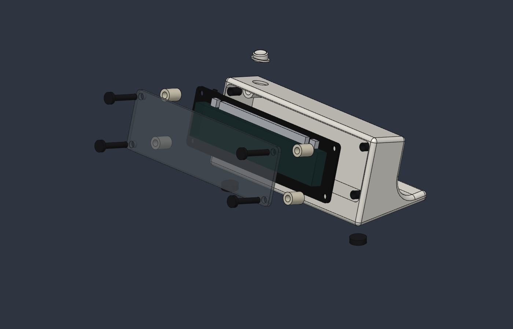
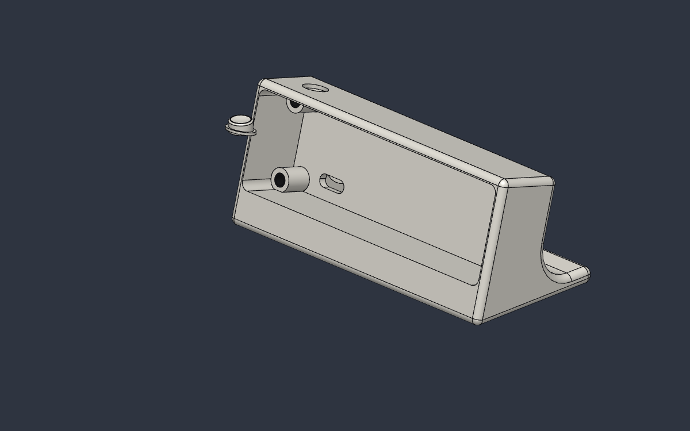
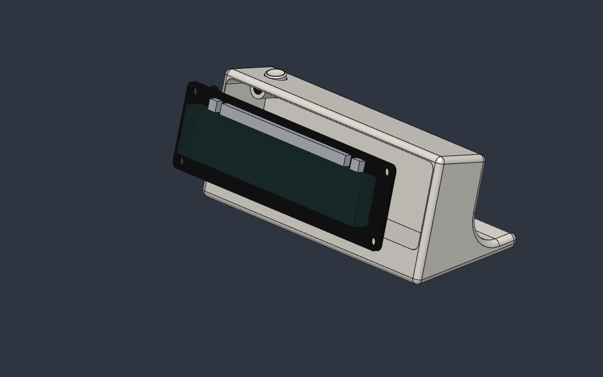
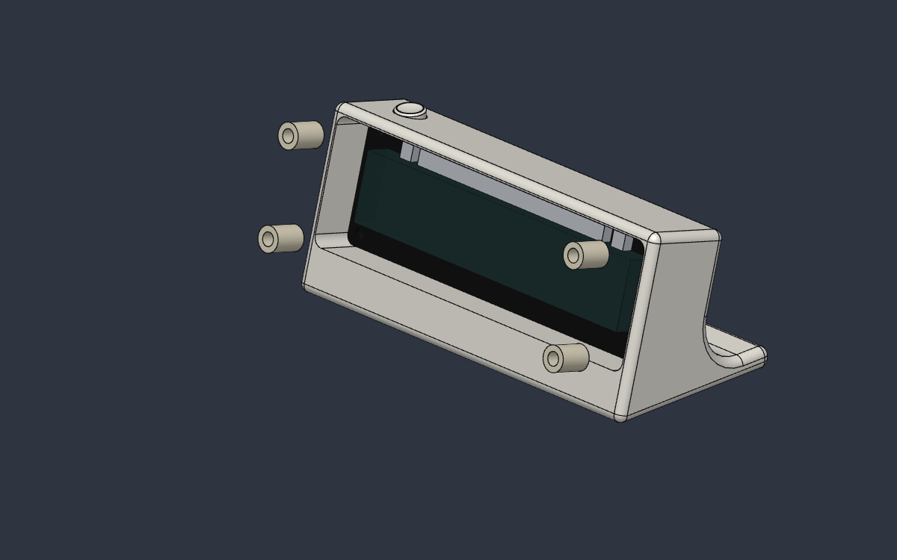
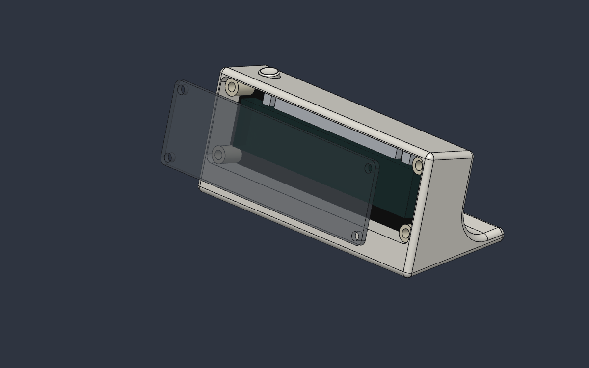
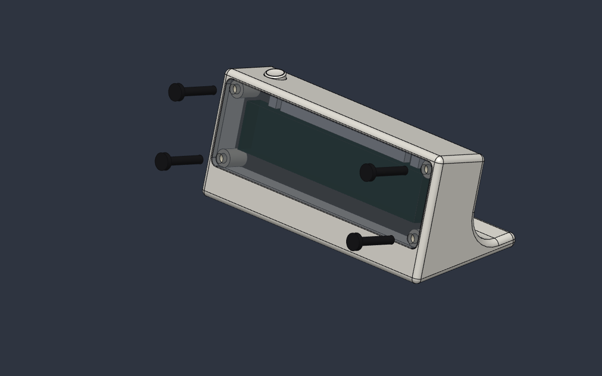

# VFD clock case: assembly guide

## Parts

**Print** (files in `print/`)
| File | Part | Suggested settings |
|---|---|---|
| `case.3mf` | Case | PLA or PETG, 0.2 mm layers, 4 walls, 20 % infill. Print standing on its base as exported. The front opening and USB notch need no supports, but enable supports for the button recess under the top wall. |
| `button-cap.3mf` | Button cap | Print upright with a brim and supports under the flange. It's tiny, so 0.12 mm layers give a smoother fit. |

**Buy**
| Qty | Part | Notes |
|---|---|---|
| 4 | M3 × 16 button-head bolt, black (ISO 7380) | |
| 4 | M3 heat-set insert, 5.7 mm long, for a Ø4.0 mm hole | For example Ruthex RX-M3x5.7 |
| 4 | M3 round spacer, 8 mm long, outside diameter ≤ 6 mm, unthreaded | Nylon is fine |
| 4 | Ø8 mm self-adhesive rubber bumper, 2–3 mm tall | |
| 1 | USB-C cable | |

You also need the clock PCB and the 1.8 mm tinted acrylic front panel that came with it.

**Tools:** a soldering iron (with an insert tip if you have one) and a 2 mm hex key.

## Steps

### 1. Heat-set inserts

Heat the iron to about 220 °C for PLA (245 °C for PETG). Press an insert into each of the four bosses inside the case, from the front. Keep it square and stop when it's flush with the boss face. Let them cool.

### 2. Button cap

From inside the case, push the button cap up through the hole in the top, dished end first. Its flange sits in the recess under the top wall, and the cap can't come out once the PCB is in. Check that it slides freely. If it binds, run a 7.5 mm drill through the hole by hand.

### 3. PCB

Slide the PCB into the pocket with the VFD facing out and the USB-C port at the bottom left when seen from the front. The back of the board rests on the four bosses, the USB-C port lines up with the cutout in the back, and the board's button sits under the cap.

### 4. Spacers

Put an 8 mm spacer over each mounting hole on the front of the PCB.

### 5. Acrylic front

Lay the acrylic on the spacers, lining up its holes. Peel the protective film first. The acrylic sits flush with the front of the case.

### 6. Bolts

Fit an M3 × 16 bolt through each corner, through the acrylic, spacer and PCB and into the insert. Tighten gently in a cross pattern. Stop when the acrylic is snug, or it can crack.

### 7. Rubber feet

Stick a bumper into each of the four recesses: two under the front and two under the back lip, either side of the cable notch.

### 8. Cable

Plug the USB-C cable in at the back. The plug drops into the notch in the curved back, and the cable runs out across the lip.

## Done

Press the cap on top to use the clock's button.
