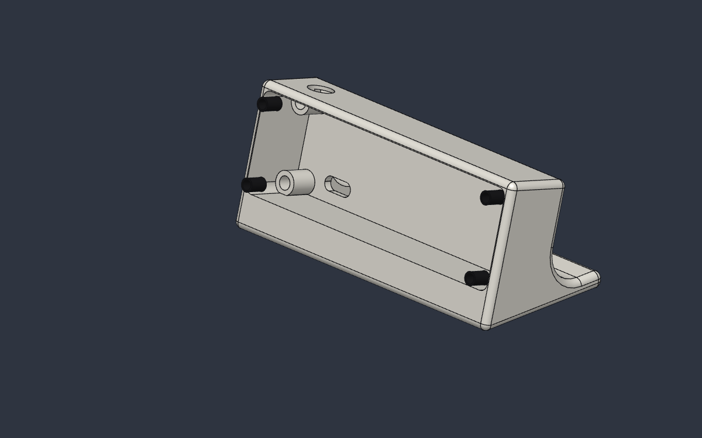
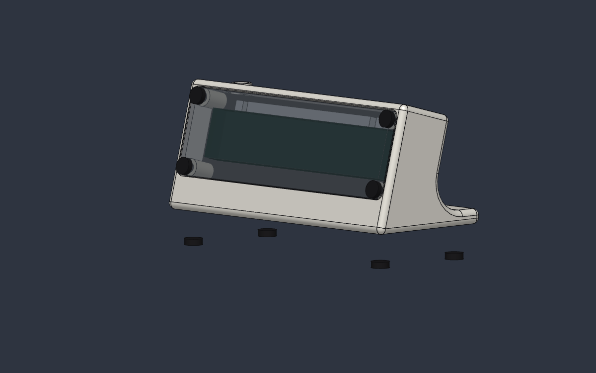
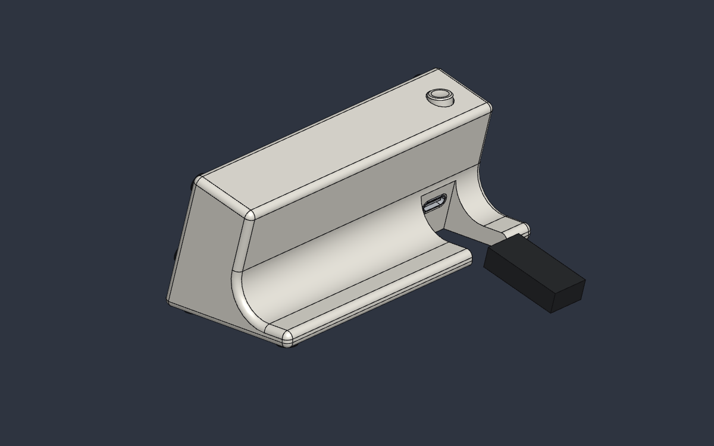
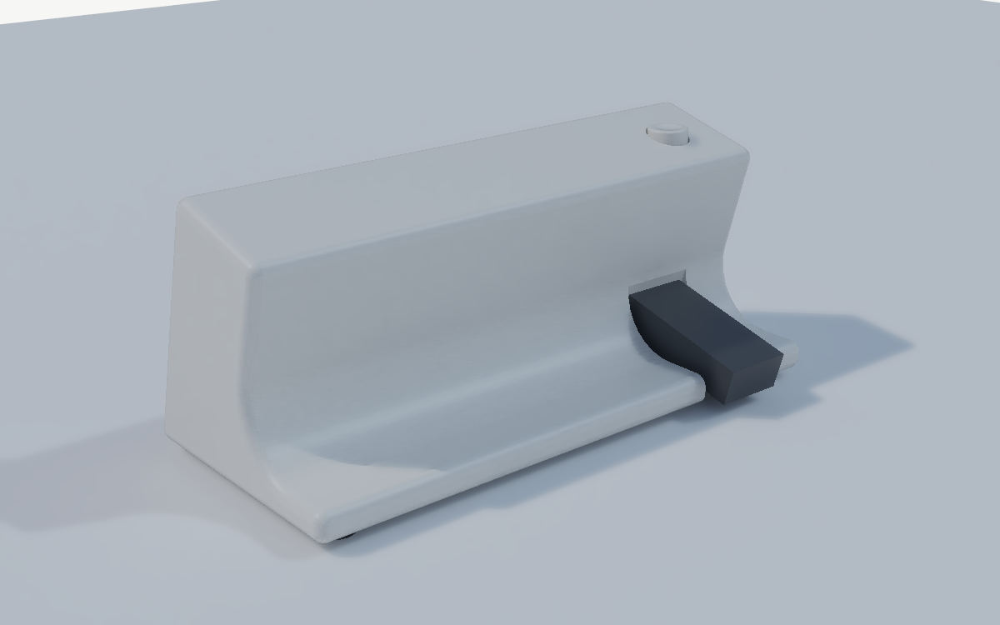

# Assembly guide

About 20 minutes once the parts are printed. See the [README](README.md) for the shopping list and print settings.

**Tools:** a soldering iron (an insert tip helps), a 2 mm hex key, and tweezers or pliers for pulling support material.

## 0. Clean up the print

Pull the support material out of the front opening. Check that these are clear:
- the 4 insert holes;
- the round button hole in the top, plus the D-shaped recess underneath it;
- the USB-C slot at the back.

Drop the button cap into its hole from the top to test the fit. It should slide freely with a little play. If it binds, turn a 7.8 mm drill bit through the hole by hand, or sand the cap lightly.

## 1. Heat-set inserts

Set the iron to about 220 °C for PLA or 245 °C for PETG.
1. Rest an insert on a boss inside the case and press it in slowly and squarely until it's flush with the boss face.
2. Repeat for all four bosses.
3. Let them cool before the next step.

## 2. Button cap

1. From inside the case, push the cap up through the hole in the top, dished end first.
2. Its flange sits in the recess under the top wall. Turn the cap so the flat edge of the flange faces the nearby corner boss, and it drops fully home.
3. Once the PCB is fitted, the cap can't fall out.

## 3. PCB

Slide the PCB into the opening with the VFD facing out. The USB-C port goes at the back, lower left as seen from the front.
- The back of the board sits on the four inserts.
- The port lines up with the slot in the back.
- The board's button sits under the cap.

## 4. Spacers

Put an 8 mm spacer over each of the four corner holes on the front of the PCB.

## 5. Acrylic front

Peel the protective film off the acrylic. Lay it on the spacers with its holes lined up. It sits flush with the front of the case.

## 6. Screws

Fit an M3 × 16 screw through each corner, through the acrylic, spacer and PCB and into the insert.
- Tighten in a cross pattern until the acrylic is just snug. Overtightening cracks acrylic.
- Press the button cap. You should feel the board's button click.

## 7. Rubber feet

Stick a Ø6 mm bumper into the shallow recess in each corner underneath.

## 8. Cable

Plug the USB-C cable in at the back. The plug drops into the notch in the curved back, and the cable runs out across the lip.

## Done

