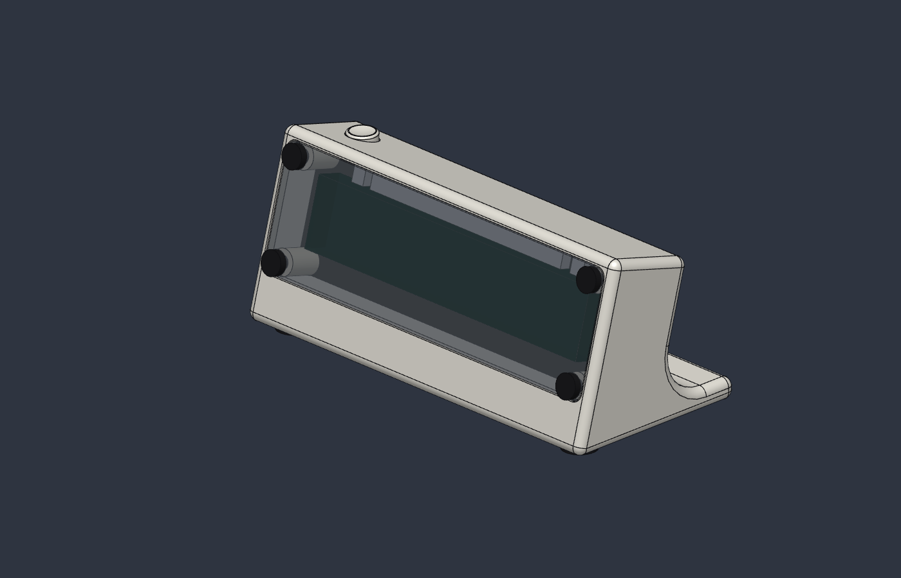

# vfd-case

A desk case for the VFD clock, modelled in SolidCraft. The face tilts back 15° toward the viewer.

**Build it:** see [ASSEMBLY.md](ASSEMBLY.md) for parts, print settings and the illustrated step-by-step guide.

| Path | What |
|---|---|
| `print/case.3mf`, `print/button-cap.3mf` | The two printed parts |
| `export/vfd-case-assembly.step` | The full assembly for other CAD tools |
| `export/vfd-case-assembly.glb` | The full assembly with colours, for viewers |
| `guide/` | Assembly renders |
| `vfd-case.sc` | The SolidCraft design, with components and explode views |
| `pcb.json` | Script for the PCB reference model |
| `case.json` | Script for the case, acrylic, spacers, hardware and plug. It also applies the tilt and colours |
| `assembly.json` | Groups the bodies into components and creates the explode views (`Exploded` and `Step 1`–`Step 8`) |

**Rebuild:** run `pcb.json`, then `case.json`, then `assembly.json` into a new design. For example, with three MCP `batch` calls using `path`. Then re-export with `export` and re-render the guide.

## Hardware (all standard metric)
| Qty | Part | Notes |
|---|---|---|
| 4 | M3 × 16 button-head bolt (ISO 7380) | Goes from the front through the acrylic, spacer and PCB into the insert |
| 4 | M3 round spacer, 8 mm long, OD ≤ 6 mm, unthreaded | Sits between the acrylic and the PCB, clearing the VFD by 1.75 mm |
| 4 | M3 heat-set insert, 5.7 mm long, for a Ø4.0 hole | Goes in the case bosses. The thread is in the insert, so no nuts are needed |
| 4 | Ø8 self-adhesive rubber bumper, 2–3 mm tall | Sits in the recesses: two under the front, two under the back lip |

## Case
- **Walls:** 2.4 mm. Every exterior edge is rounded at R2: the front perimeter (rounding back from the face), all four front-view corners, the bottom edges and the lip. The 10 mm back cove is the one deliberate exception.
- **Front:** a PCB-shaped pocket with 0.3 mm clearance and 2.42 mm corner radius. The acrylic sits flush with the front face.
- **Back:** the USB-C port sits flush with the back face, through a 9.54 × 3.86 mm cutout.
- **Button:** a single Ø7 push-cap that stands vertical, with a level top and a 0.4 mm dish. It comes straight out of a Ø7.4 bore in the sloped top, with no collar. It stands 0.5 mm proud at the front and 2.4 mm at the back. Inside, a hidden flange tilted parallel to the wall sits in a recess under the top and keeps the cap from falling out. Drop it in from inside before fitting the PCB. Nothing flexes.
- **Base:** the body sits straight on the desk at a 15° tilt, with a full-width wedge under the front. A curved cove at the back runs into a 5 mm lip that extends 22 mm back to stop it tipping. A 14 mm notch through the cove and lip gives the USB-C plug room, and the plug clears the desk by 2.4 mm. There are 4 recesses for Ø8 rubber feet, two under the front and two under the lip, either side of the USB notch, all kept clear of the R2 edges.

## Coordinates (PCB frame, before tilt; mm)
- Z is up and the front (VFD side) faces −Y.
- The PCB's front face sits at y = 0.
- The PCB's bottom-left corner, seen from the front, is at the origin.

**Measurements:**
- PCB: 93.8 × 28.8 × 1.6, corner radius 2.12 (a 3 mm caliper chord ÷ √2).
- VFD: 6.25 deep.
- Pins: stick out 2.7, 3.75 tall.
- USB-C: standard 8.94 × 3.26, 10.65 deep.
- Button casing: 4.65 × 2.6, standing 2 off the back of the PCB, with its top edge 0.42 below the PCB's top edge. Its plunger is 1.95 × 0.95 and points up (+Z).
