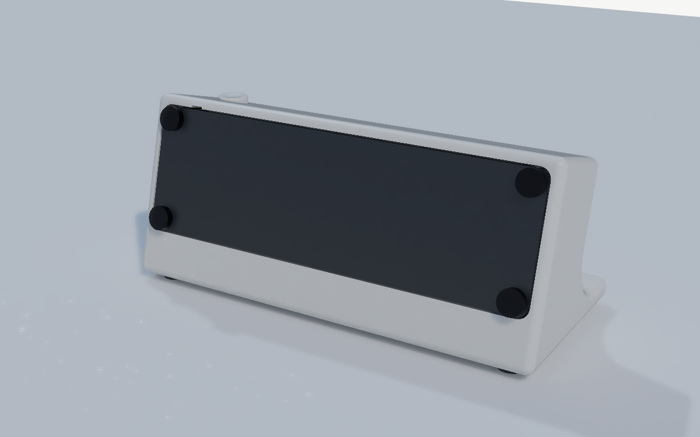
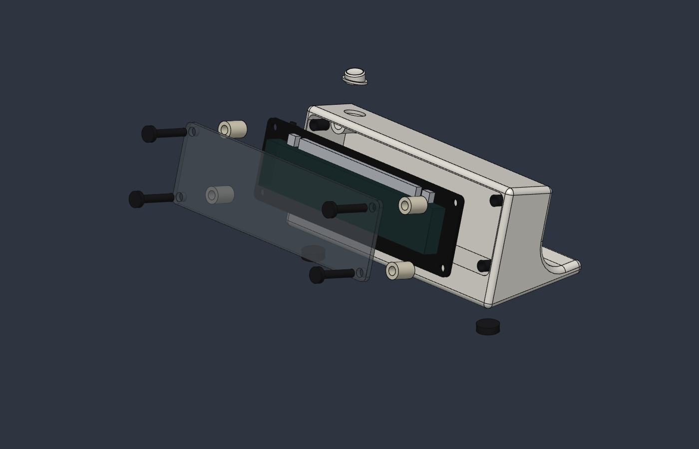

# VFD clock desk case

A 3D-printable desk stand for a 93.8 × 28.8 mm VFD clock PCB and its tinted acrylic front. The face tilts back 15° toward you, a curved back lip stops it tipping, the USB-C cable runs out the back, and there's a press-button on top.

**3D preview:** GitHub opens STL files in an interactive viewer. Click [the full assembly](preview/vfd-case-assembled.stl) or [just the printed case](preview/case.stl), then drag to rotate. (GitHub can't embed the viewer inside a README.)

## 1. Buy

| Qty | Part | Notes |
|---|---|---|
| 4 | M3 × 16 button-head screw, black (ISO 7380) | 2 mm hex key |
| 4 | M3 heat-set insert, 5.7 mm long, for a Ø4.0 mm hole | e.g. Ruthex RX-M3x5.7 |
| 4 | M3 round spacer, 8 mm long, unthreaded, OD 5 mm (6 mm max) | Nylon is fine |
| 4 | Ø6 × 2 mm self-adhesive rubber bumper | The common small round size |
| 1 | USB-C cable | |

You also need the clock PCB and the 1.8 mm acrylic front panel that came with it. No nuts are needed, because the inserts take the thread.

## 2. Print

Both files are already oriented for printing. Open them in your slicer as they are.

| File | Material | Settings |
|---|---|---|
| [`print/case.3mf`](print/case.3mf) | PLA or PETG | 0.2 mm layers, 3–4 walls, 15–20 % infill. **Supports:** on, set to *everywhere*, tree or organic. They're only needed under the roof of the front opening, and they come out through the front. |
| [`print/button-cap.3mf`](print/button-cap.3mf) | Same | 0.12 mm layers. No supports. It prints standing on its dished top. Add a brim if your bed is fussy. |

**Print the cap first**, since it's tiny. Once the case is done, check that the cap slides freely in the case's button hole. If it binds, see the fix in the assembly guide.

## 3. Assemble

The full illustrated walk-through is in **[ASSEMBLY.md](ASSEMBLY.md)**. In short:

1. Melt the 4 inserts into the bosses inside the case, using a soldering iron at about 220 °C.
2. Push the button cap up into its hole from inside. Its tab goes toward the middle of the case.
3. Seat the PCB, VFD forward, with the USB-C port at the back lower left. Press it to the bottom of the opening as it starts in.
4. Put a spacer on each corner hole, then lay the acrylic on top.
5. Fit the 4 screws through the acrylic, spacers and PCB into the inserts. Snug, not tight.
6. Stick a rubber foot in each corner recess underneath. Plug in the cable.

## Design notes

- **Fits and clearances:** these allow for FDM tolerance and were checked in CAD with an interference check across every part.
  - PCB and acrylic pocket: 0.4 mm each side.
  - USB-C cutout: 0.5 mm each side.
  - Button cap in its bore: 0.3 mm each side.
  - Button cap: retained by a hidden tab on the side away from the top-left insert boss. The tab sits in a keyed pocket, so the cap lifts at most 0.4 mm and turns at most about 5°.
- **Assembly checked as motion, not just the final position.** Each part was swept along its real path and checked for collisions at every step. The cap clears the boss on the way in. The board's button clears the case as the PCB slides in: it passes the front edge with the board pressed to the bottom of the opening (0.2 mm clear), then runs in a 3 mm groove in the ceiling. The groove stops behind the acrylic, so the face is untouched. The cap's stem is squared to the board, and pressing the cap reaches the board's button.
- **Insert holes:** 7 mm deep for 5.7 mm inserts, so displaced plastic has somewhere to go.
- **Edges:** every exterior edge is rounded at 2 mm. The 10 mm curve at the back is the one exception.
- **Cable clearance:** with the feet fitted, the USB-C plug clears the desk by 2.2 mm.

## Files

| Path | What |
|---|---|
| `print/` | The print files: case and button cap |
| `preview/` | Lighter STL meshes for GitHub's 3D viewer. These are not for printing |
| `export/vfd-case-assembly.step` / `.glb` | The full assembly, for other CAD tools or 3D viewers |
| `guide/` | Renders and assembly-step images |
| `vfd-case.sc` | The SolidCraft design, with components and explode views (`Exploded`, `Step 1`–`Step 8`) |
| `pcb.json`, `case.json`, `assembly.json` | Scripts that rebuild the design from scratch, in that order. Run each with a SolidCraft MCP `batch` call using `path` |
